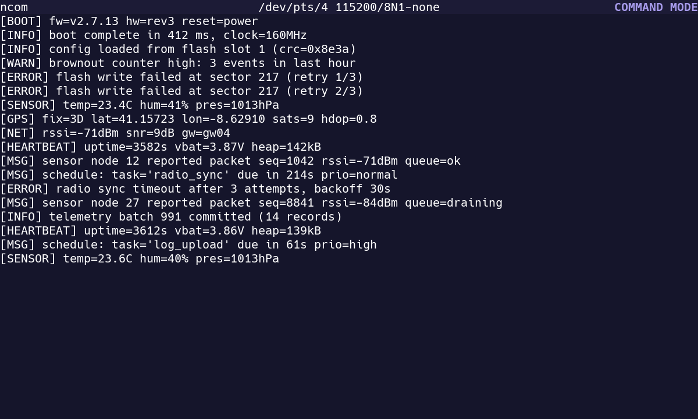
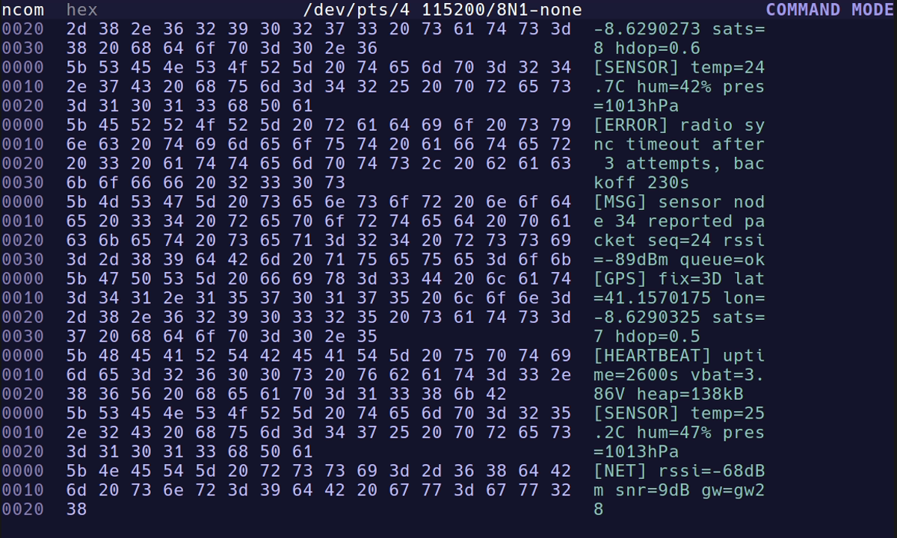
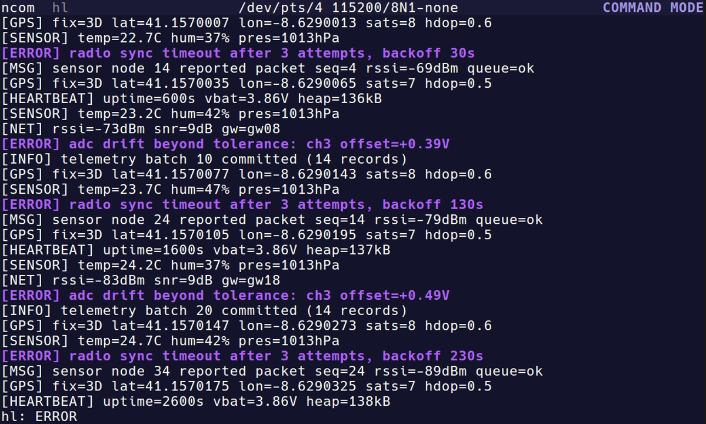
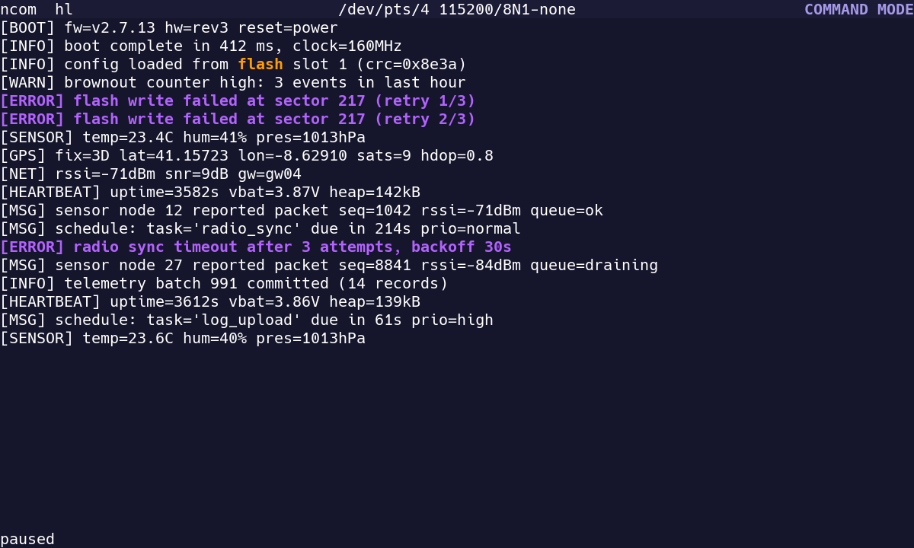
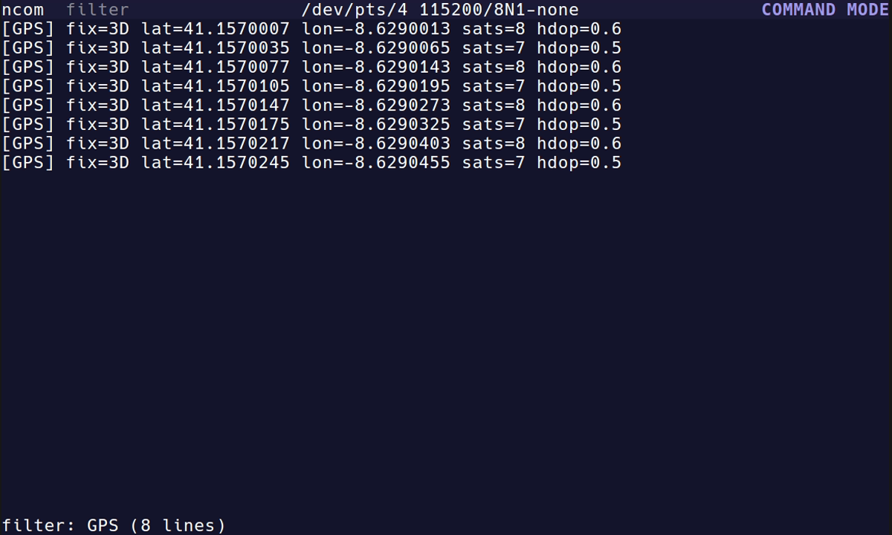
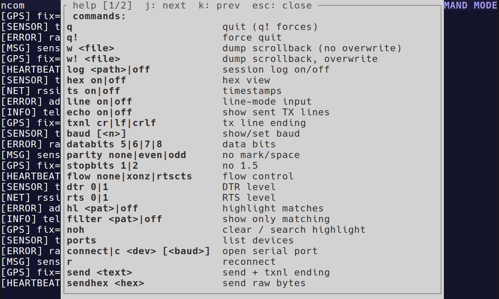
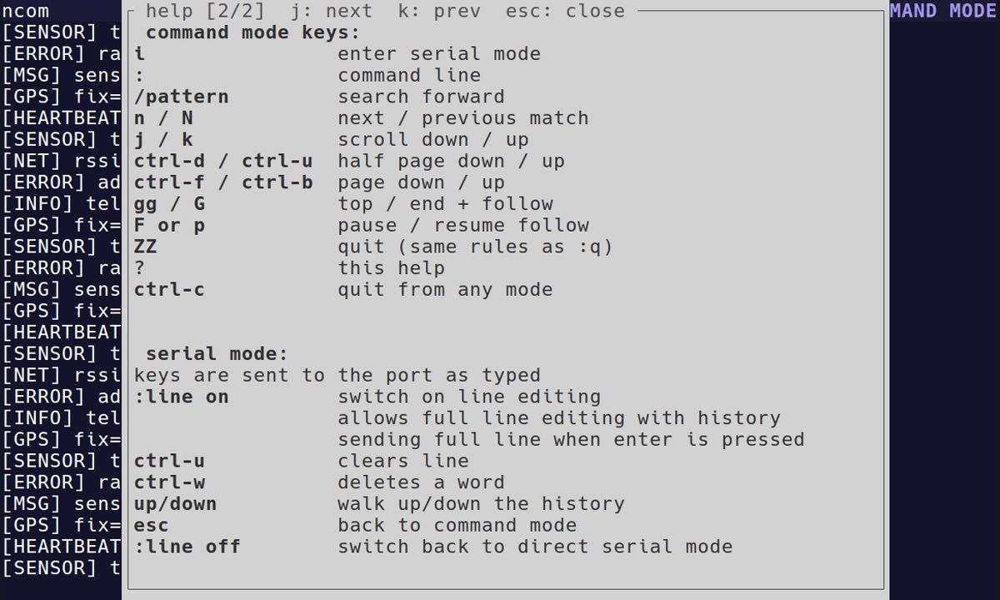
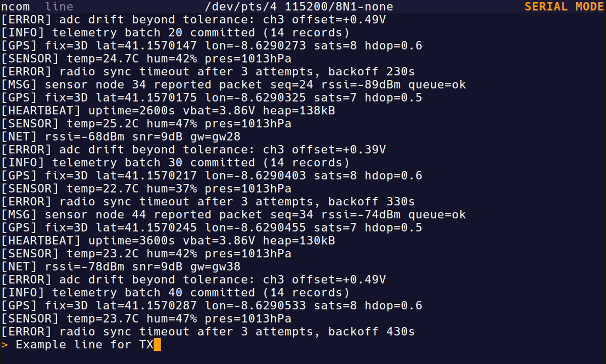

# ncom

**ncom** is a modal, vi-like serial terminal TUI written in Rust. It connects
to serial devices with scrollback, search, and an ex-style `:` command line
for connecting and live reconfiguration.

## Screenshots

Short demo (highlight, search, filter) — regenerate with
`scripts/record.sh` (or `vhs scripts/demo.tape`); a larger `demo.webm`
master sits next to the GIF:


Command mode with follow-tail over a telemetry stream:



`:hex on` — offset, byte and ASCII columns in distinct tones:



`:hl ERROR` — whole-line highlight on matching traffic:



`:hl error` whole-line highlight combined with a `/flash` search:



`:filter GPS` — only matching lines, snapped to the filtered tail:



`:help` popup over dimmed scrollback:



The second help page — `j` moves on, `k` back:



Line insert mode with the input bar and block cursor:



## Install

Requires Rust >= 1.85 and cargo (Linux) — the crate uses edition 2024. No
extra system libraries are needed — the `serialport` crate is built without
its default `libudev` feature.

Build from source and copy the single binary:

```sh
cargo build --release
install -Dm755 target/release/ncom ~/.local/bin/ncom
```

For a fully static binary (no glibc dependency, runs on any Linux):

```sh
rustup target add x86_64-unknown-linux-musl
cargo build --release --target x86_64-unknown-linux-musl
install -Dm755 target/x86_64-unknown-linux-musl/release/ncom ~/.local/bin/ncom
```

The musl target links with `ld.lld` (the local, git-ignored
`.cargo/config.toml` also folds identical code with `--icf=all`, shrinking
the binary). Have `ld.lld` on your `PATH` — e.g. from the system `lld`
package, or rustup's bundled
`lib/rustlib/x86_64-unknown-linux-gnu/bin/gcc-ld/ld.lld` — or the link falls
back to the default `cc` → `ld.bfd`, which also works (just without ICF).

`~/.local/bin` must be on your `PATH`. To uninstall, `rm ~/.local/bin/ncom`.

## Usage

```sh
ncom --port /dev/ttyUSB0 --baud 115200
```

Or start without `--port` and run `:ports` to list devices, then
`:connect <dev> [<baud>]`.

Essentials:

- Modes: `i` enters serial mode (shown as `SERIAL MODE`; vi-like INSERT),
  `Esc` returns to command mode (shown as `COMMAND MODE`; vi-like NORMAL),
  `:` enters the vi-like ex command line (shown as `CMD` on the bottom row).
- Scrolling: `j` / `k` scroll down/up, `G` jumps to the newest line and
  resumes follow-tail.
- `/pattern` searches (case-insensitive, `n` / `N` to navigate).
- `:filter <pattern>` shows only matching lines (`:filter off` restores the
  full scrollback — nothing is deleted), and `:hl <pattern>` highlights every
  line that contains the pattern in its entirety (`:hl off` clears). Both use
  the same case-insensitive matching as
  `/` and can be combined; with a filter active, `/` searches within the
  filtered view. On lines the hl pattern matches, the whole-line highlight
  takes precedence over `/` match spans (search spans still render on all
  other lines).
- Serial mode sends keystrokes to the port; useful commands there: `:line on|off`
  (line-editing vs raw passthrough), `:hex on|off` (hexdump view),
  `:ts on|off` (timestamps), `:log <path>` (session logging), `:baud <n>`
  (live baud change), `:r` (reconnect), `:q` (quit).

## Testing with socat

No serial hardware? Use `socat` to fake one.

Create a virtual serial pair:

```sh
socat -d -d pty,raw,echo=0 pty,raw,echo=0
# prints the two pty paths, e.g. /dev/pts/3 and /dev/pts/4
ncom --port /dev/pts/4
echo "hello" > /dev/pts/3   # appears in ncom's scrollback
```

Bridge a TCP source (e.g. a network serial console) into a pty ncom can open:

```sh
socat -d -d pty,raw,echo=0 tcp:192.168.1.50:23
ncom --port /dev/pts/4
```

Whatever the remote sends appears in ncom; bytes typed in SERIAL MODE go to
the TCP peer.

Or feed synthetic traffic with `scripts/serial_feeder.py` (Python + uv,
stdlib only; deterministic boot log + telemetry at 5 lines per second).
It creates its own pty and publishes the device path to a file:

```sh
cd scripts && uv run serial_feeder.py --port-file /tmp/ncom-port &
sleep 0.5
ncom --port "$(cat /tmp/ncom-port)"   # in another terminal
```

It exits when the port closes (Ctrl-C stops it).

## Configuration

Theme colours are configured in a TOML file at
`${XDG_CONFIG_HOME}/ncom/config.toml` (fallback `~/.config/ncom/config.toml`):

```toml
[theme]
topbar     = "#1c1b36"
body       = "#15152b"
foreground = "#ffffff"
normal     = "#a599e9"
insert     = "#ff9d00"
hl         = "#b362ff"
cmd        = "#fad000"
error      = "#ff628c"
tx         = "#ff9ed2"
hex_offset = "#8a80b8"
hex_byte   = "#c3bfff"
hex_ascii  = "#8fc7b8"
```

`hl` styles the whole-line `:hl` highlight; `/` search matches use `insert` —
the two highlight colours are separately configurable (the `hl` default is the
theme's comment purple, `insert` the operator orange). `tx` styles
local-echo lines (`:echo on`, light pink by default).
`hex_offset`, `hex_byte` and `hex_ascii` style the `:hex on` view's offset
column, hex byte column and ASCII gutter respectively (a dim-to-bright tonal
ladder by default — the bytes are the primary data).
The top bar uses `topbar`; the body (scrollback, prompt
and status lines) uses `body`, a shade darker by default. Missing keys (or a
missing file) fall back to the defaults; invalid
values produce a startup warning and fall back per key.

## Licence

ncom is licensed under the GNU Affero General Public License v3.0 or later — see [LICENSE](LICENSE).
